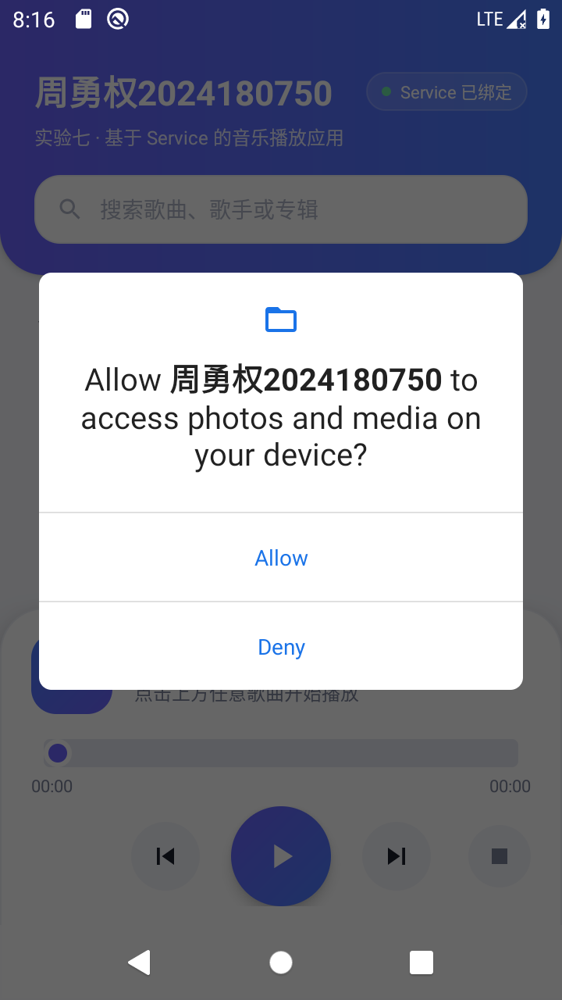
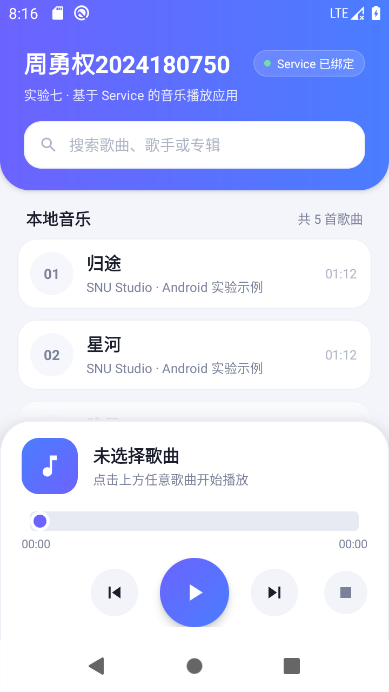
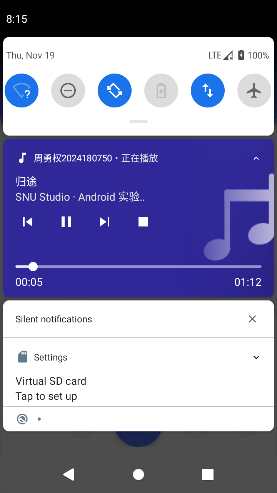
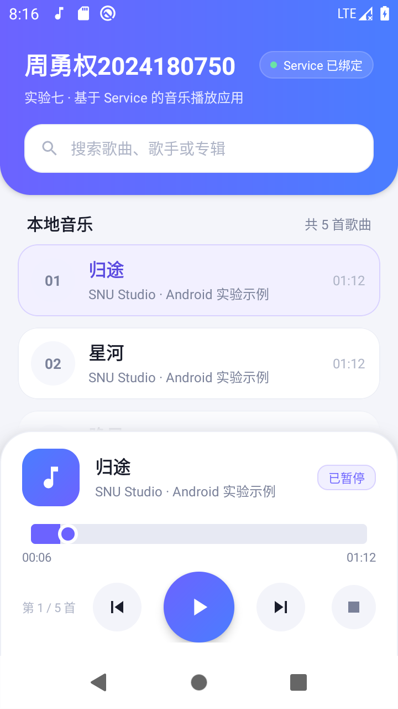
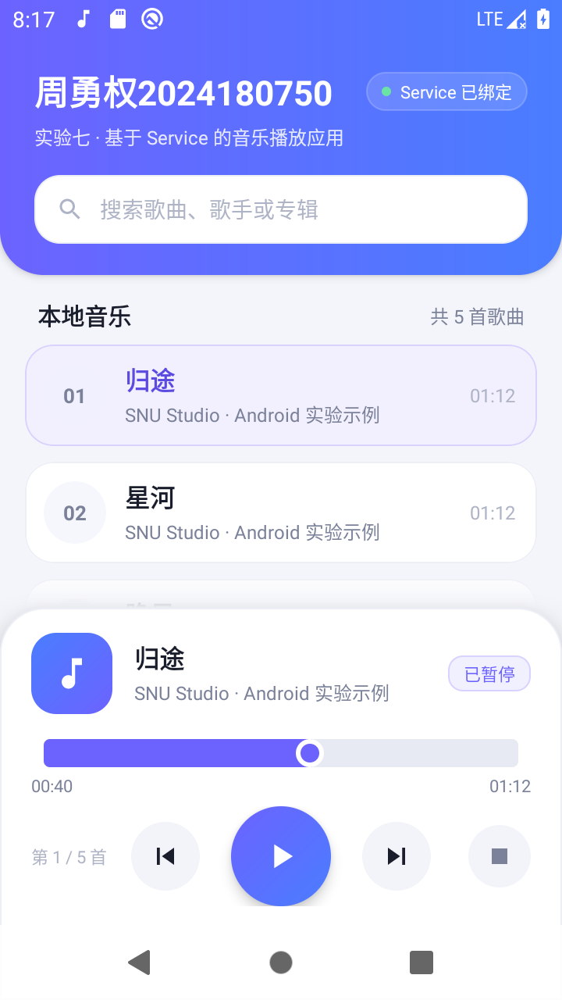
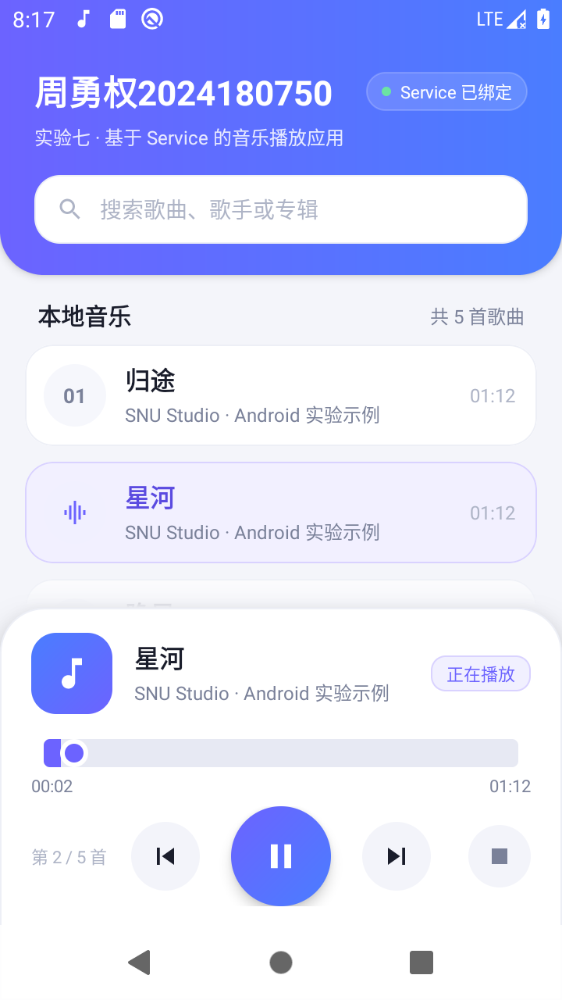
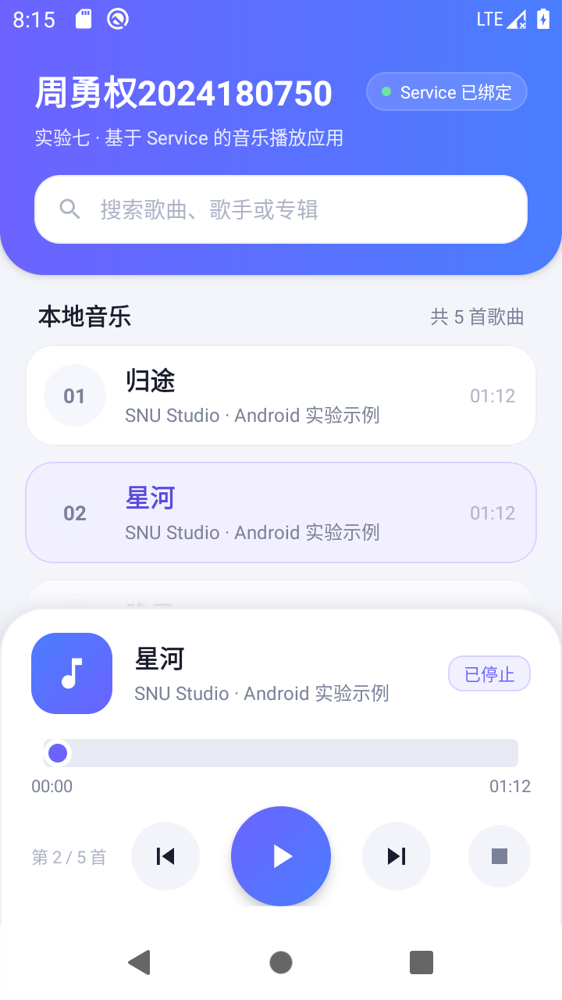
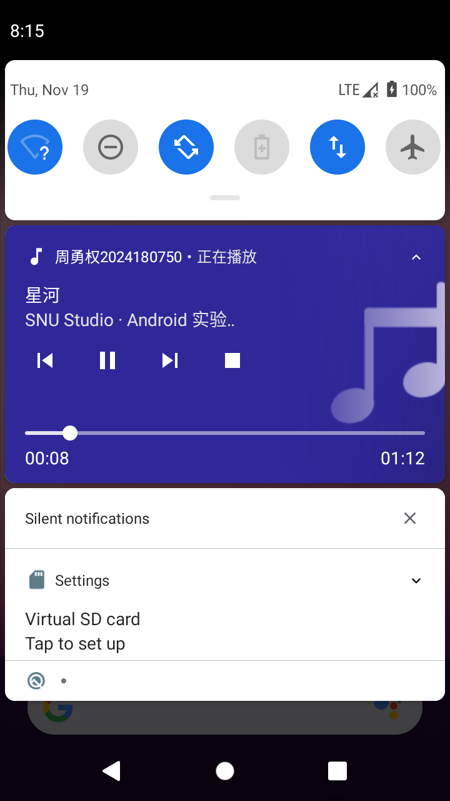
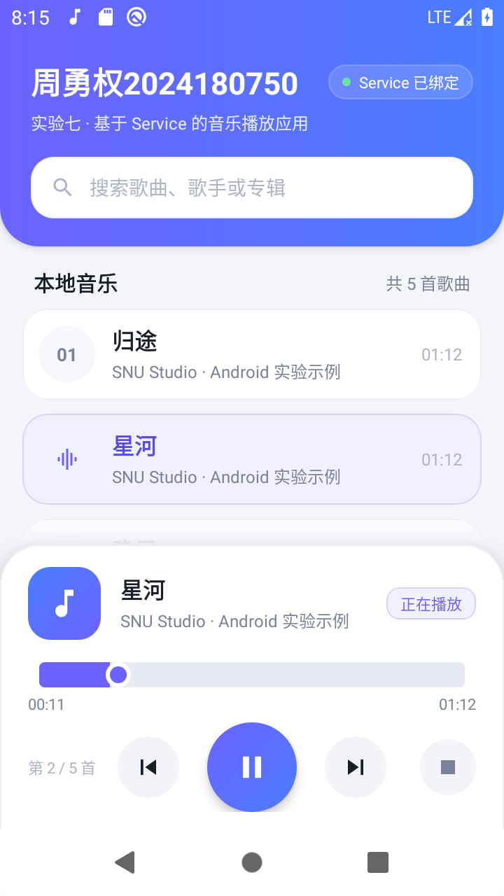
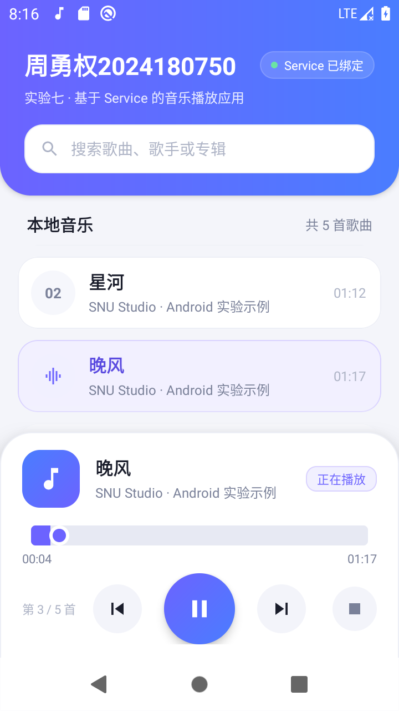

# 周勇权 2024180750 —— Android 实验七 · 基于 Service 的音乐播放应用

四川师范大学计算机科学学院《Android 移动应用开发》实验七。

- 姓名：周勇权
- 学号：2024180750
- 项目名：MusicService（应用名「周勇权2024180750」）
- 包名：`cn.edu.sicnu.musicplayer`
- 仓库地址：<https://github.com/zyongquan/Music_Service->
- 开发环境：Android Studio + AGP 9.3.3 / Gradle 9.5.0 / JDK 17 / compileSdk 37 / minSdk 24
- 测试机型：Android 10（API 29）模拟器，720 × 1280

## 一、功能与实验要求的对应关系

| 实验要求 | 实现位置 |
| --- | --- |
| (1) 使用 ContentResolver 获得音乐文件列表 | `SongRepository.query()`：查询 `MediaStore.Audio.Media`，过滤 `IS_MUSIC != 0`，用 `ContentUris` 拼出播放地址 |
| (2a) 所有播放相关功能在 Service 中实现 | `MusicPlayerService`：持有唯一的 `MediaPlayer`，提供播放 / 暂停 / 停止 / 上一首 / 下一首 / 拖动进度 |
| (2b) Activity 通过绑定服务拿到 Binder，读取歌曲名与播放进度 | `MainActivity` 的 `ServiceConnection` 拿到 `MusicPlayerService.MusicBinder`，调用 `snapshot()` 并注册 `PlaybackListener` |
| (3) SeekBar 实时显示播放进度（多线程）、可拖动调整 | 服务内 `HandlerThread("music-progress")` 每 500ms 读取 `currentPosition`，切回主线程刷新 SeekBar；拖动时调用 `seekTo()` |
| (4) 换歌时用 Notification 在通知栏显示歌曲名 | `MusicPlayerService` 前台通知 + `MediaStyle`，显示歌名 / 歌手 / 专辑 / 播放状态，带 4 个控制按钮 |
| 注意：SDK 13+ 需要 READ_MEDIA_AUDIO | `AndroidManifest.xml` 同时声明 `READ_MEDIA_AUDIO`（33+）与 `READ_EXTERNAL_STORAGE`（≤32），运行时按版本申请 |
| 提交要求 (1)：APP 标题改为姓名 + 学号 | `app_name` = 周勇权2024180750，界面头部、通知栏、任务列表一致 |

## 二、运行截图

| 权限申请（Android 13 以下为 READ_EXTERNAL_STORAGE） | 首页：从 MediaStore 读到的歌曲列表 |
| --- | --- |
|  |  |

| 正在播放（列表高亮 + 跳动图标） | 通知栏显示当前歌曲 |
| --- | --- |
|  |  |

| 暂停（暂停时依然保留通知） | 拖动 SeekBar 调整进度 |
| --- | --- |
|  |  |

| 下一首 | 停止（通知移除、进度归零） |
| --- | --- |
|  |  |

| 退出界面后音乐在后台继续播放 | 重新进入界面后状态自动恢复 |
| --- | --- |
|  |  |

| 一首播完自动播放下一首 |
| --- |
|  |

## 三、项目结构

```text
Music_Service/
├── app/src/main/
│   ├── java/cn/edu/sicnu/musicplayer/
│   │   ├── MainActivity.kt          # 界面：列表、搜索、底部播放面板、权限、绑定服务
│   │   ├── MusicPlayerService.kt    # 核心：MediaPlayer、Binder、进度线程、通知、MediaSession
│   │   ├── SongRepository.kt        # ContentResolver 查询 MediaStore
│   │   ├── Song.kt                  # 歌曲数据类 + 时长格式化
│   │   ├── Playback.kt              # 播放状态快照 / 回调接口
│   │   ├── SongAdapter.kt           # RecyclerView + DiffUtil
│   │   └── ArtworkFactory.kt        # 代码绘制通知栏封面
│   ├── res/layout/
│   │   ├── activity_main.xml        # 渐变头部 + 搜索 + 列表 + 播放面板
│   │   └── item_song.xml            # 歌曲条目
│   ├── res/drawable/                # 背景、图标、SeekBar 样式
│   └── AndroidManifest.xml          # 权限、Service、前台服务类型
├── docs/screenshots/                # 运行截图
├── build.gradle.kts
├── settings.gradle.kts
└── gradle/libs.versions.toml
```

## 四、关键实现

### 1. 用 ContentResolver 读取音乐列表

```kotlin
val collection = MediaStore.Audio.Media.EXTERNAL_CONTENT_URI
val selection = "${MediaStore.Audio.Media.IS_MUSIC} != 0"
resolver.query(collection, PROJECTION, selection, null, SORT_ORDER)?.use { cursor ->
    val id = cursor.getLong(cursor.getColumnIndexOrThrow(MediaStore.Audio.Media._ID))
    // content://media/external/audio/media/<id>，MediaPlayer 可以直接打开
    val uri = ContentUris.withAppendedId(collection, id)
    ...
}
```

MediaStore 里没有标签的歌曲会返回 `null` 或 `<unknown>`，统一替换成「未知艺术家 / 未知专辑」；
文件名兜底作为标题，避免出现空白行。

### 2. Service + Binder：播放全部在服务里

`MusicPlayerService` 是同时支持 `bindService` 与 `startService` 的服务：

- `MusicBinder` 暴露服务实例，Activity 通过它调用 `playAt / pause / resume / stopPlayback / next / previous / seekTo`；
- 服务内部只有一个 `MediaPlayer`，并用 `setWakeMode(PARTIAL_WAKE_LOCK)` 保证后台播放；
- 播放时调用 `startForeground()` 进入前台，退出界面后音乐继续播放；
- 用 `MediaSessionCompat` 同步锁屏 / 通知栏的播放状态，并处理耳机按键、音频焦点与拔耳机自动暂停。

### 3. SeekBar 实时进度：子线程读取 + 主线程刷新

```kotlin
progressThread = HandlerThread("music-progress").apply { start() }
progressHandler = Handler(progressThread.looper)

private fun startProgressTicker() {
    val ticker = object : Runnable {
        override fun run() {
            val position = mediaPlayer?.currentPosition?.toLong() ?: 0L
            val duration = mediaPlayer?.duration?.toLong() ?: 0L
            // 子线程计算，主线程更新 SeekBar
            mainHandler.post { listeners.forEach { it.onProgress(position, duration) } }
            progressHandler.postDelayed(this, 500)
        }
    }
    progressHandler.post(ticker)
}
```

拖动 SeekBar 时，`onStartTrackingTouch` 把 `isUserSeeking` 置为 `true`，暂时忽略服务推送的进度；
`onStopTrackingTouch` 时按百分比算出目标毫秒数，调用服务的 `seekTo()`。

### 4. Notification 显示当前歌曲

- 通知渠道 `music_playback`（IMPORTANCE_LOW，静默、不打扰）；
- `MediaStyle` + `MediaSessionCompat.sessionToken`，通知栏显示歌名、歌手 · 专辑、播放状态；
- 4 个按钮：上一首 / 播放暂停 / 下一首 / 停止，紧凑视图显示前 3 个；
- 换歌、暂停、恢复时都会刷新通知；停止时 `stopForeground(REMOVE)` 并把服务 `stopSelf()`；
- Android 13+ 额外申请 `POST_NOTIFICATIONS`，未授权时给出提示。

### 5. 权限

```kotlin
private fun audioPermission(): String =
    if (Build.VERSION.SDK_INT >= Build.VERSION_CODES.TIRAMISU) {
        Manifest.permission.READ_MEDIA_AUDIO      // Android 13+
    } else {
        Manifest.permission.READ_EXTERNAL_STORAGE // Android 12-
    }
```

Manifest 中 `READ_EXTERNAL_STORAGE` 加了 `android:maxSdkVersion="32"`，避免高版本继续申请旧权限。

## 五、运行方法（Android Studio）

1. 用 Android Studio 打开本目录 `Music_Service`，等待 Gradle Sync 完成（AGP 9.3.3 / Gradle 9.5）；
2. 选择一台 Android 7.0（API 24）以上的设备或模拟器，点击 Run；
3. 首次启动会申请读取音频的权限，允许后即可看到本机 Music 目录下的音乐；
4. 若列表为空：把 mp3 / m4a / ogg 等文件放进设备的 `Music` 目录，回到应用点击「重新扫描音乐」。

> 截图里的 5 首示例曲目是实验时用脚本合成的测试音频（`SNU Studio / Android 实验示例`），
> 不属于仓库代码；换成任意本机音乐即可。

## 六、功能测试

| 测试项 | 操作 | 预期 | 结果 |
| --- | --- | --- | --- |
| 权限申请 | 首次启动 | 按系统版本申请 READ_MEDIA_AUDIO / READ_EXTERNAL_STORAGE | 通过 |
| 读取列表 | 授权后 | 列出 Music 目录下 5 首歌，显示歌名 / 歌手 / 专辑 / 时长 | 通过 |
| 播放 | 点击歌曲 | 服务开始播放，列表高亮，通知栏出现歌名 | 通过 |
| 暂停 / 继续 | 点击中间按钮 | 暂停保位，通知按钮同步为「播放」 | 通过 |
| 上一首 / 下一首 | 点击两侧按钮 | 切歌，列表与通知同步，越界自动循环 | 通过 |
| 停止 | 点击右侧停止 | 回到开头、状态变为已停止、通知移除 | 通过 |
| 拖动进度 | 拖动 SeekBar | 位置文本实时变化，松手后从目标位置播放 | 通过 |
| 自动下一首 | 等待一首播完 | 自动切换到下一首 | 通过 |
| 后台播放 | 按 Home 键 | 通知栏仍在，音乐继续 | 通过 |
| 状态恢复 | 重新进入应用 | 自动同步正在播放的歌曲与进度 | 通过 |
| 通知按钮 | 在通知栏点暂停 / 下一首 | 服务响应，界面与通知同步 | 通过 |

## 七、踩到的坑

1. **Android 13 权限变更**：`READ_EXTERNAL_STORAGE` 在 33+ 不再返回音频，必须改成 `READ_MEDIA_AUDIO`，
   否则列表永远是空的。所以做了按版本分支申请。
2. **前台服务类型**：targetSdk 34+ 必须声明 `android:foregroundServiceType="mediaPlayback"` 并申请
   `FOREGROUND_SERVICE_MEDIA_PLAYBACK`，否则 `startForeground()` 直接抛异常。
3. **通知按钮图标变黑**：通知栏会用大图标（封面）取色并给按钮染色，封面颜色偏亮时图标会被染成深色，
   把代码绘制的封面换成深色渐变后，按钮颜色恢复为白色。
4. **退出界面音乐就停**：只 `bindService` 时服务会随 Activity 解绑一起销毁；播放开始时再用
   `startService` 把服务「启动」起来，才能在后台继续播放。
5. **MediaStore 没刷新**：文件放进 Music 目录后系统数据库还没更新，列表就是空的，
   需要触发媒体扫描（或重新扫描）后才能读到。

## 八、作者

周勇权 2024180750 · 计算机科学学院 · 2026 年 11 月
